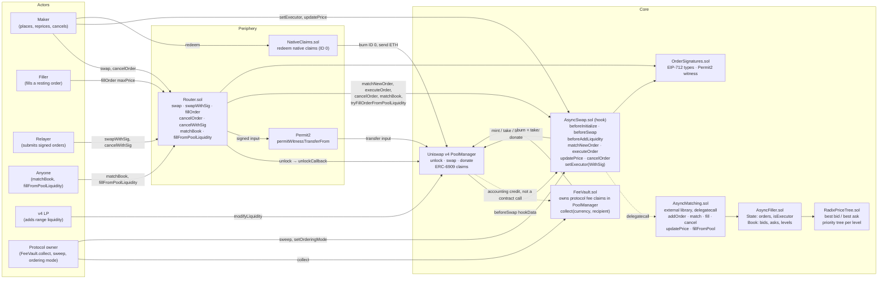
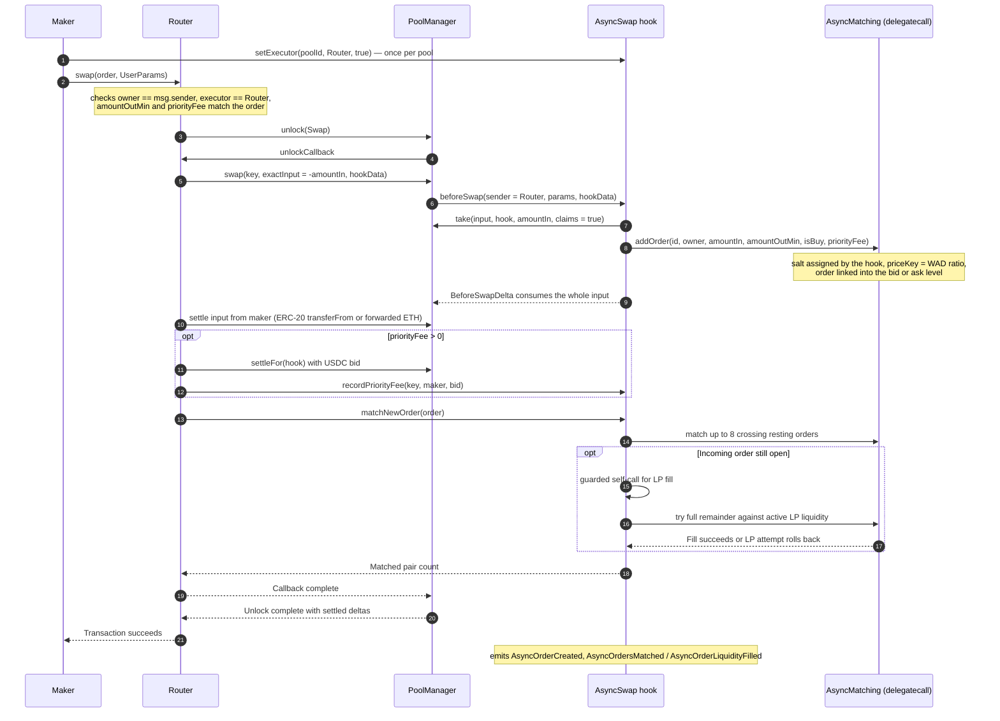

# Async Swap v2

Async Swap is a Uniswap v4 hook that turns exact-input swaps into resting limit orders with an on-chain order book and matching engine.

Diagrams: [order lifecycle](docs/order-lifecycle.md#order-lifecycle) · [priority-bid settlement](docs/order-lifecycle.md#priority-bid-settlement) · [detailed contract calls](docs/contract-call-sequences.md).

[`docs/protocol.md`](docs/protocol.md) is the overview: component map, where funds live, a short order sequence, the authorization model and the deployment shape, with links into the detailed sequences.

The live Async Swap order state is indexed by `AsyncFiller.Book`: a Patricia radix tree locates bid/ask price levels. Better prices always execute first. Each pool can use FIFO or USDC priority bids to resolve orders at the same price. In priority-bid mode, every order must bid at least $0.10 (100,000 units of six-decimal USDC); a larger bid ranks first and equal bids use FIFO. Priority bids affect matching within this book, not block-builder transaction inclusion order. Price updates re-enter with fresh time priority.

When a new order crosses the book, the Router immediately matches it against up to eight resting orders in the same PoolManager unlock. Matching burns both makers’ ERC-6909 escrow claims and transfers the corresponding tokens to the counterparties. Partial fills stay in the book; input left after a maker’s minimum output is met is returned. Priority bids are escrowed as PoolManager claims when the order is created. A proportional share is donated to currently active v4 LPs as input fills, in the same unlock as settlement. The bid is non-refundable: its remaining share is donated when the order is canceled or terminates; if the pool has no active liquidity, the amount is routed to the protocol FeeVault. If more than eight pairs are crossed, anyone can call `Router.matchBook` to continue in another bounded transaction.

Pool owners can also add ordinary Uniswap v4 liquidity positions. After order-to-order matching, Async Swap tries the remaining order against active pool liquidity. It executes only if the pool consumes the full remaining input and returns at least the maker’s remaining minimum output. Otherwise that attempt rolls back and the order remains available to another counterparty or filler. Anyone can retry a resting order through `Router.fillFromPoolLiquidity` after liquidity or the pool price changes. These fills charge a 30 bps v4 LP fee, accrued to active positions; LPs bear the usual inventory and price risk.

The standalone `MatchingEngine` is an algorithm and stress-test harness; its measurements do not describe the integrated hook’s gas use. Priority bids only resolve same-price book matches. They do not reserve a transaction’s first or last position in a block, prevent builders from reordering transactions, or guarantee execution. Active v4 liquidity means positions in range at the current tick when `donate` runs; out-of-range LP positions do not receive that donation.

## Protocol overview



Every pool that uses the hook must contain the chain's USDC (`numeraire`) and use the dynamic-fee flag
(`beforeInitialize`). `beforeAddLiquidity` is a pass-through: anyone may add ordinary v4 range
positions, and they are the inventory for the LP-fill path. No swap ever reaches the AMM curve
directly, because `beforeSwap` consumes the whole input as an order; the only AMM swaps are the ones
the hook itself performs when it fills a resting order from pool liquidity. The standalone
`MatchingEngine.sol` is a benchmark harness and is not deployed.

FeeVault owns claims recorded in PoolManager. Crediting those claims does not call FeeVault.


## Contract call sequence



Signed orders follow the same path through `swapWithSig`. The maker signs one Permit2
`PermitWitnessTransferFrom` whose witness is `OrderSignatures.hashOrder(order)`, so the signature
both moves the input and commits to the order. A relayer can also attach a signed `SetExecutor` grant
for the maker's first order on a pool.


Repricing only changes the order book; it does not trigger matching or an LP fill. Filler protocol fees come from the filler’s gross output payment, not maker input escrow.

See [the full protocol map](docs/protocol.md) for custody and authorization, [detailed call sequences](docs/contract-call-sequences.md) for fills, retries and withdrawals, and [order lifecycle and priority bids](docs/order-lifecycle.md) for settlement rules.

## Build and deployment

`AsyncMatching` is an external Solidity library linked into the hook. Deploy it once on each target chain with `forge create src/libraries/AsyncMatching.sol:AsyncMatching --rpc-url "$RPC_URL" --broadcast --account "$DEPLOYER_ACCOUNT"`, set the returned address as `ASYNC_MATCHING_LIBRARY_ADDRESS` in `.env.deploy`, then run `script/deploy-unichain.sh`; the wrapper verifies the library code and links that address into the CREATE2 hook bytecode. The Foundry test runner links the library automatically.

Install dependencies and run the contract suite with:

```sh
forge soldeer install
forge test
```

Run the local block-packing and adversarial gas benchmark with:

```sh
./script/stress-matching-engine.sh
```

The benchmark starts a fresh local Anvil chain with a 30M gas block limit. A run on 2026-10-14 measured:

| Workload | Transactions included | Block gas used |
| --- | ---: | ---: |
| 100 distinct ordinary prices | 100 | 22.29M / 30M |
| Adversarial high-bit radix paths | 83, then 17 next block | 29.04M / 30M, then 8.89M |
| 100 orders, each filling eight makers | 100 | 26.14M / 30M |

These are local measurements, not production-chain guarantees. The adversarial orders stayed pending for the next block instead of reverting; the stress script reproduces all three scenarios.
