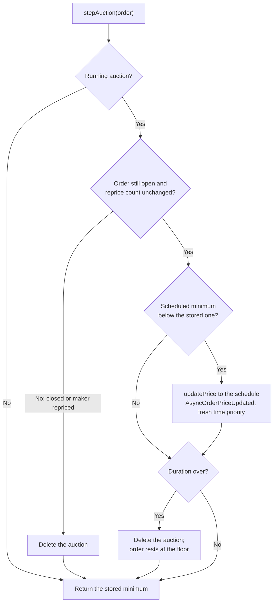
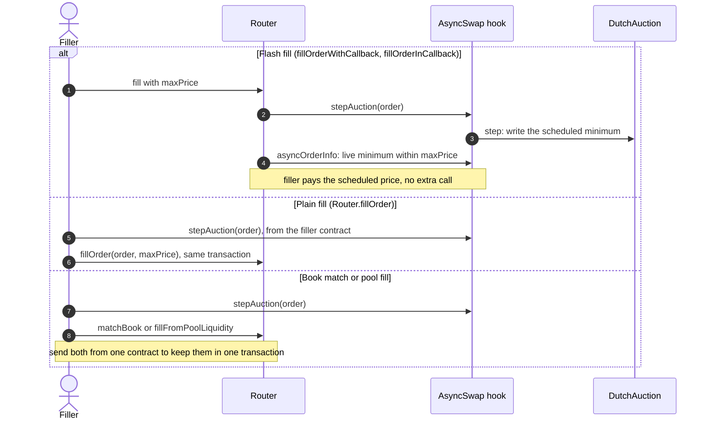

# Dutch auction orders

A maker can turn a resting order into a Dutch auction. The order's minimum output starts at its current value and
falls in a straight line to a floor over a number of blocks. Fillers fill it as soon as the price works for them,
so the maker gets a price found by competition rather than a fixed quote. The logic lives in the linked
`DutchAuction` library; the auction record is stored in the hook by order id.

## Start an auction

Place the order as usual, at the price you would like to get. Then call the hook directly:

```solidity
hook.startAuction(order, floorAmountOutMin, duration);
```

* Only the maker can start an auction.
* `floorAmountOutMin` is the least output you accept. It must be above zero, below the order's current minimum,
  and meet the pool's order minimums.
* `duration` is in blocks, from 1 to `DutchAuction.MAX_DURATION` (50,000).
* The hook emits `AuctionStarted(orderId, start, floor, startBlock, duration)`.

The scheduled minimum at block `b` is:

```
start - (start - floor) * (b - startBlock) / duration
```

It rounds in the maker's favour and stays at the floor once the duration ends.

## Steps

`hook.stepAuction(order)` writes the scheduled minimum into the order through the normal reprice path, so the book
always holds a real price. Anyone can call it, untaxed. It does nothing for an order with no running auction, and
returns the order's minimum output after the step.



Between steps the stored minimum is at or above the schedule, so a match or fill never pays the maker less than
the schedule gives. Each step is a reprice: it gives the order fresh time priority and increments its reprice
count, which also voids any reprice the maker signed earlier.

## Fills



Book matches and pool fills use the stored price, so a step is what lets the book see the newer price. `maxPrice`
still binds every filler fill.

## Stop or change an auction

* Cancel the order as usual.
* Or reprice it with `updatePrice` or a signed reprice. A maker reprice stops the auction, and the order then
  rests at the maker's new price.
* Calling `startAuction` again replaces the running schedule, starting from the order's current minimum.
