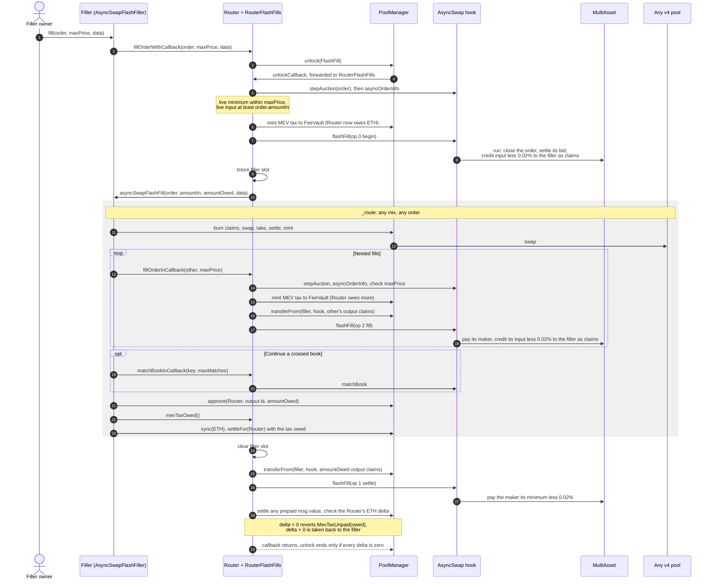
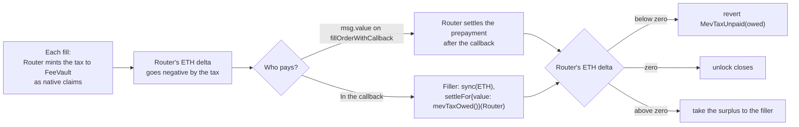
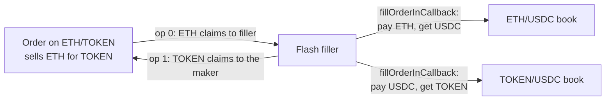

# Flash fills and non-numeraire pools

A flash fill lets a filler fill an order with no inventory. The Router gives the filler the order's escrowed input
first, as ERC-6909 claims, calls the filler back inside its own `PoolManager.unlock`, and only then collects the
maker's output. Inside the callback the filler can swap on any Uniswap v4 pool, fill other Async Swap orders with
`fillOrderInCallback`, and run `matchBookInCallback`, in a loop it controls. This is v4 flash accounting: nothing
has to be funded up front, as long as every delta is zero when the unlock ends.

## Interfaces

* `IAsyncSwapCallback`, served by the Router: `fillOrderWithCallback` opens a fill; `fillOrderInCallback` and
  `matchBookInCallback` work only while that callback runs, and only for its filler; `mevTaxFor` and
  `mevTaxOwed` price the tax.
* `IAsyncSwapFlashFiller`, implemented by the filler: `asyncSwapFlashFill(order, amountIn, amountOwed, data)`.
* `AsyncSwapFlashFiller` (`src/periphery`): an abstract base that implements the callback. Inherit it and write
  `_route`.

The Router serves `IAsyncSwapCallback` from `RouterFlashFills`, a module it creates in its constructor and runs by
DELEGATECALL from its `fallback`, so every call runs as the Router. The Router's `unlockCallback` forwards a
`FlashFill` unlock to the same module. On the hook side, `AsyncSwap.flashFill(args)` is Router only and runs three
ops in the linked `MultiAsset` library: 0 begin, 1 settle, 2 fill paid in claims.

## Flow

Every payment inside a flash fill is a claim: the order's input is credited to the filler as claims, a nested
fill pulls its output from the filler as claims (`transferFrom`, so the filler approves the Router per currency),
and the final maker check pulls the owed output as claims. A route that only moves between Async Swap books never
opens a PoolManager delta at all. Swaps on other v4 pools are bridged with `burn` (claims to credit) and `mint`
(credit to claims). Native ETH is claim id 0.

The maker of the outer order is paid as in a plain fill: ERC-20 output as tokens, native output as claims. Any
surplus above `amountOwed` stays with the filler.

## Paying the MEV tax

Each flash fill owes the MEV tax once per fill: the outer fill and every `fillOrderInCallback`.
`matchBookInCallback` pays none, as `matchBook` is open to anyone anyway. The tax is paid flash-accounting style:

* Off chain, `mevTaxFor(fills)` quotes the tax for `fills` fills. Call it with the gas price you will send
  (`eth_call` with `gasPrice`, or `forge script --with-gas-price`).
* Inside the callback, `mevTaxOwed()` returns exactly what the Router still owes: every fill charged so far
  less what was paid.
* With no priority fee the tax is zero.

`AsyncSwapFlashFiller` pays `mevTaxOwed()` from its own ETH balance at the end of the callback.
`ethNeeded(fills)` tells the owner how much ETH to send with `fill`, and `script/FlashFill.s.sol` sends exactly
that. `withdraw` returns surplus ETH and claims to the owner.

## Safety rules

| Rule | Enforcement |
|---|---|
| The flash-filled order cannot be repriced, cancelled, topped up, matched or filled again during the callback. | Op 0 deletes it before the callback; later calls find `OrderNotFound`. |
| No other Router entry point runs during the callback. | Each opens its own `unlock`, which v4 refuses (`AlreadyUnlocked`). A nested `fillOrderWithCallback` reverts `FlashFillActive`. |
| Only the active filler may use the in-callback entry points. | `onlyFlashFiller` reads the transient filler slot, cleared before the output is collected. |
| The maker check is on the final amount only. | The owed output is pulled once, after the callback. |
| Resting orders filled inside a flash fill are never worse off. | `fillOrderInCallback` applies the same live minimum, `maxPrice`, `order.amountIn` bound and 0.02% fees as `fillOrder`. |
| Dutch auction orders fill at the scheduled price. | Both entry points call `stepAuction` before reading the price. |
| Only the Router drives the hook side. | `flashFill` reverts `NotTrustedRouter` for any other caller and checks the maker's executor grant. Op 1 only settles the order op 0 opened in the same transaction (transient record in the hook). |

## Non-numeraire pools

A maker can place an order on a pool without the numeraire, for example ETH/TOKEN. Fillers fill it like any
order, and a flash fill routes it through the two numeraire books with no inventory: sell into one book, buy from
the other, and the USDC in the middle nets to zero inside the PoolManager.

| Rule | Detail |
|---|---|
| Who may open one | Anyone, once both tokens already have a numeraire pool on this hook with the same tick spacing. Otherwise `MultiAsset.initialize` reverts `NumeraireRequired`. The check reads only the hook's storage. |
| Fee | Dynamic-fee flag, as for every pool. |
| Quote side | `currency1`. Orders paying `currency1` are bids, orders paying `currency0` are asks. |
| Minimum order | Each side's decimal floor, `10^(decimals - assetPrecision)` of that token, at least 1 unit. No dollar minimum. |
| Priority bids | Not allowed, since bids are paid in the numeraire. A nonzero `priorityFee` or a top-up reverts `PriorityFeeNeedsNumeraire`. |

The floors stop dust, not small orders: 0.0001 of a cheap token can be worth very little. Stablecoins other than
the numeraire are ordinary tokens here.
