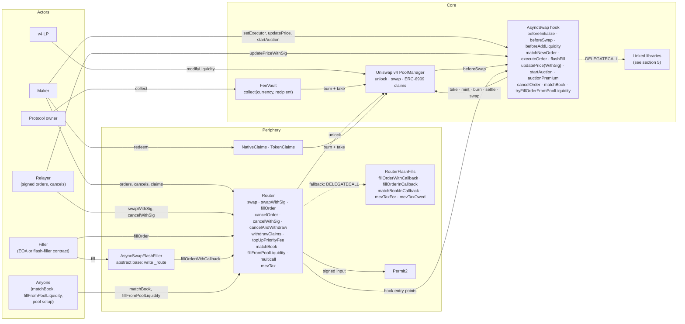
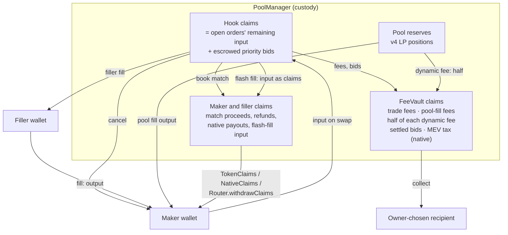
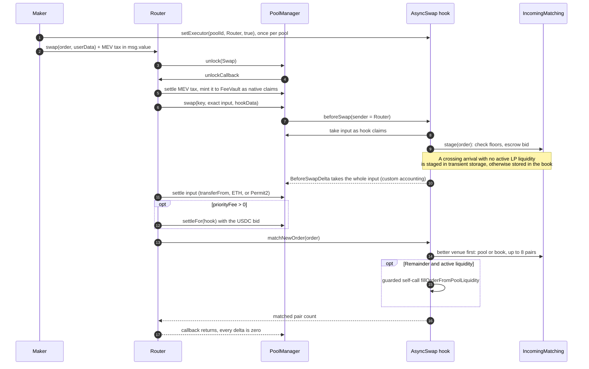
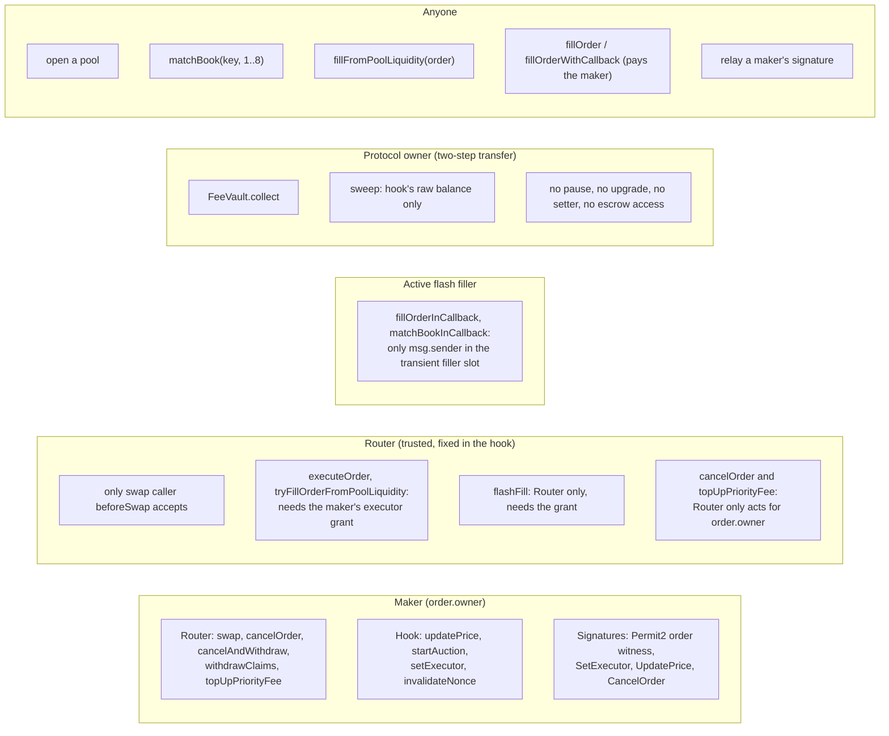
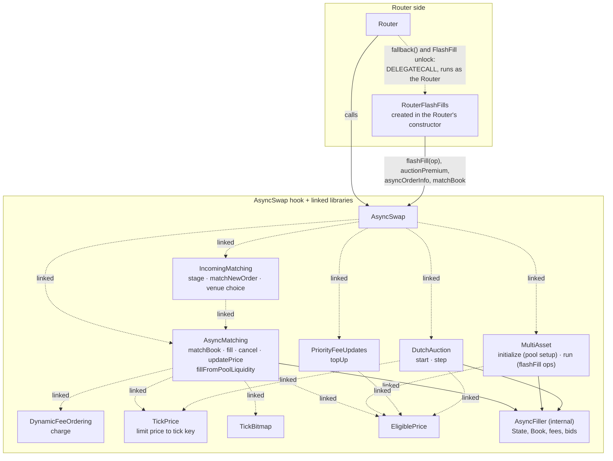
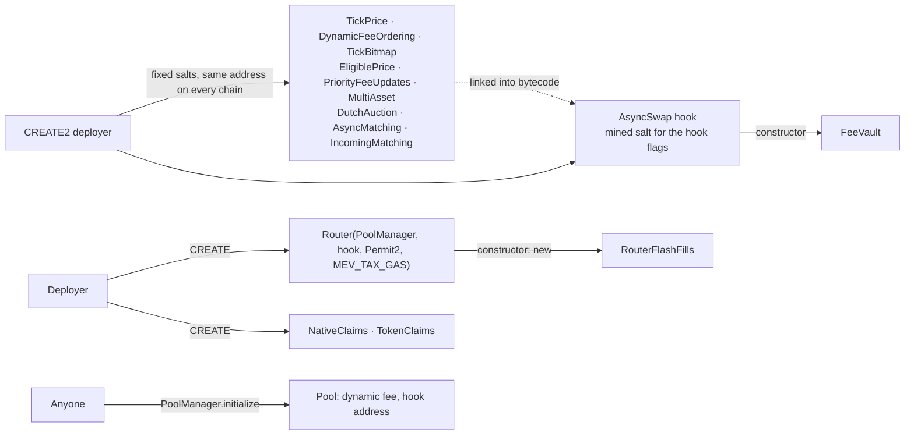

# Async Swap protocol

Async Swap is a Uniswap v4 hook that turns exact-input swaps into resting limit orders. The hook uses v4
custom accounting (`beforeSwapReturnDelta`) to take the whole swap input as an order, and v4 flash accounting
(one `PoolManager.unlock` per action, every delta zero at the end) to settle matches, fills and fees. Orders
are good till cancelled (GTC): there is no expiry, so an order rests until it fills or the maker cancels it.

This page is the entry point. It shows the contracts, where funds sit, how an order is placed, and who may do
what. Every box names a contract, library or function in `src/`, so the diagrams can be checked against the code.

## Guides

| Guide | Covers |
|---|---|
| [Order lifecycle and priority bids](/protocol/order-lifecycle) | Create, match, reprice, top up, cancel; bid settlement |
| [Flash fills and non-numeraire pools](/protocol/flash-fills) | `fillOrderWithCallback`, nested `fillOrderInCallback`, the per-fill MEV tax, pools without USDC |
| [Dutch auction orders](/protocol/dutch-auction) | `startAuction`, steps, fills |
| [Contract call sequences](/protocol/contract-call-sequences) | Step-by-step calls for placement, fills, cancels, setup and withdrawals |
| [Priority fee top-ups](/protocol/priority-fee-top-ups) | `topUpPriorityFee` and agent batching |
| [Signed price changes](/protocol/repricing-signatures) | `UpdatePrice` and `CancelOrder` typed data |
| [Price keys and crossing](/protocol/price-key-crossing) | How limit prices become v4 tick keys and when two orders cross |
| [Dynamic fee ordering](/protocol/dynamic-fee-ordering) | How pool-fill backruns pay LPs and the protocol |
| [Deployments](/deployments) | Addresses per chain |

## 1. Components

Anyone may open a pool on the hook with the dynamic-fee flag. A pool that holds the chain's USDC (`numeraire`)
opens freely. A pool without it, such as ETH/TOKEN, opens once both tokens already have a numeraire pool on this
hook with the same tick spacing; see [non-numeraire pools](/protocol/flash-fills#non-numeraire-pools).

Each order must meet two floors, fixed when the pool opens:

* **Minimum order** on the quote leg: USDC on a numeraire pool, from the constructor's whole-dollar
  minimum scaled by `decimals()`.
* **Asset floor** on the other leg: `10^(decimals - assetPrecision)` base units (0.0001 token with the
  deployed precision of 4). Native ETH counts as 18 decimals; an asset with no code is rejected.

No check reads a price, and nothing has a setter, so the owner cannot change the rules under live orders.
`beforeAddLiquidity` is a pass-through: ordinary v4 range positions are the inventory for pool fills. No user
swap reaches the AMM curve directly, because `beforeSwap` takes the whole input as an order. The standalone
`MatchingEngine.sol` is a benchmark harness and is not deployed.

## 2. Where funds live

| Fee | Rate | Paid by | Event |
|---|---|---|---|
| Trade fee, book match or filler fill (plain or flash) | 0.02% of what each side receives, rounded up | both sides | `OrderFeeAccrued`, one per side |
| Protocol fee, pool fill | 0.01% of the input swapped | the order | `OrderFeeAccrued` |
| LP fee, pool fill | 0.02% dynamic LP fee | the order | PoolManager `Swap` |
| Dynamic fee, pool fill that backruns | half the price gap it closes | the order, in its output | `DynamicFeeCharged` |
| Priority bid | maker's choice, USDC, non-refundable | the maker | settles with fills and closes |
| MEV tax | priority fee per gas × `MEV_TAX_GAS`, in ETH | the transaction, per order creation or fill | Router `MevTaxPaid(payer, amount)` |

`calculatePoolFee` and `calculateHookFee` are zero. A maker's guarantee is its minimum output minus 0.02%.
Refunds and cancels are not charged. See [dynamic fee ordering](/protocol/dynamic-fee-ordering) for the pool-fill fee.

**MEV tax.** The Router charges `mevTax()` on `swap`, `swapWithSig`, `fillOrder` and `fillFromPoolLiquidity`,
and on every flash fill (the outer fill and each nested `fillOrderInCallback`). On a chain that orders
transactions by priority fee, searchers racing for one position bid that fee up, and the tax turns most of the
bid into protocol revenue. A transaction with no priority fee pays nothing. Plain actions pay it in `msg.value`;
flash fills pay it in flash-accounting style, see [paying the MEV tax](/protocol/flash-fills#paying-the-mev-tax).
Cancels, claims, top-ups and `matchBook` are not taxed. A searcher can still race untaxed by
repricing its own order and settling it with `matchBook`; no user loses funds that way, the protocol only
collects less (acknowledged in the 2026-11-01 Pashov review, findings 4, 5, 6 and 9).

**Invariant.** The hook's claim balance per currency equals the remaining input of open orders plus escrowed
bids, fuzzed by the matching invariant suites. The hook's own token balance is zero between transactions, so
`sweep` only moves funds sent to the hook by mistake.

## 3. Placing an order

Signed orders follow the same path through `swapWithSig`: one Permit2 `PermitWitnessTransferFrom` whose witness
is `OrderSignatures.hashOrder(order)`, plus an optional signed `SetExecutor` grant. An order's id is
`keccak(chainId, poolId, owner, zeroForOne, salt)`; the hook assigns the salt and emits it in `AsyncOrderCreated`.

The new order goes to the better venue first. If the pool has active liquidity and its spot price is strictly
better than the best opposing level, the pool fills up to that level and the book takes the rest. Otherwise
the book matches first and the pool must take the whole remainder or roll back. See the
[lifecycle](/protocol/order-lifecycle) for everything after placement.

## 4. Authorization

`Router.multicall` runs several Router calls atomically as the caller. It is not payable, so native-value
actions are sent on their own. The Router can never be revoked as an executor (`CannotRevokeTrustedRouter`), so
a maker's orders are never trapped. Signed maker actions use unordered nonces in `AsyncSwap.nonceUsed`;
`invalidateNonce` revokes any of them.

## 5. Modules and libraries

Measured with solc, the hook and Router sit near the EIP-170 limit, so most logic runs in linked libraries and one
Router module. Public library functions run by DELEGATECALL in the hook's context, so escrow, books and transient
records stay in the hook.

`RouterFlashFills` called directly reaches the hook as itself, not as the Router, and `flashFill` refuses it
(`NotTrustedRouter`). Its code counts toward the Router's initcode, not its runtime.

## 6. Deployment shape

`script/deploy.sh <chain-key> [dry-run|broadcast|verify]` runs this sequence from `script/config/chains.json`.
`MEV_TAX_GAS` comes from the chain's `deployment.mevTaxGas`: 20,000,000 on Unichain, whose blocks are ordered by
priority fee, and 0 on chains ordered another way, where it would only tax ordinary tips. Measure contract
sizes with `forge build && python3 script/check-contract-sizes.py`.
