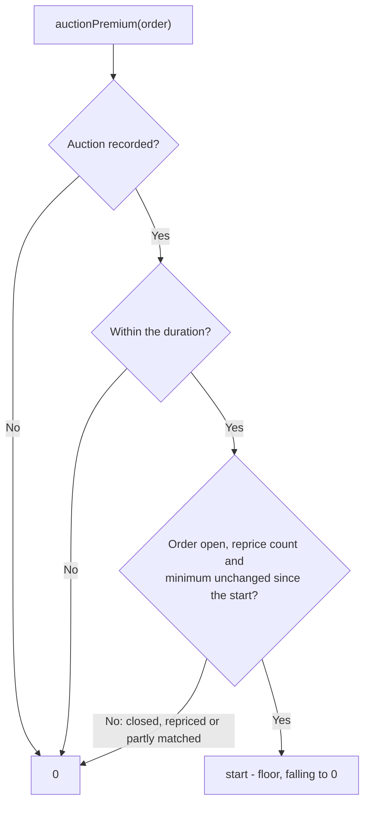
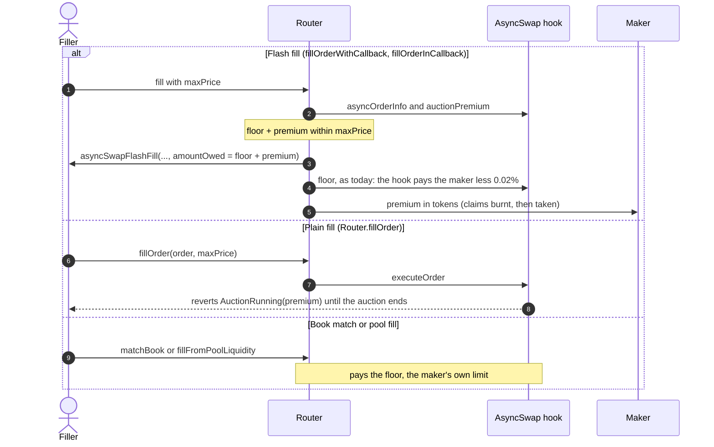

# Dutch auction orders

A maker can open a resting order with a short Dutch auction. The order rests in the book at the maker's minimum
output, the **floor**, the whole time. On top of it, flash fillers pay a **premium** that starts high and falls in a
straight line to zero. Fillers fill as soon as the total works for them, so the maker gets the best price they
compete for. When the auction ends the premium is zero and the order is a plain good-till-cancelled order at the
floor. Nothing has to be stepped, and no keeper is needed. The logic lives in the linked `DutchAuction` library; the
auction record is stored in the hook by order id.

## Start an auction

Place the order at the amount you want to receive. Then call the hook directly:

```solidity
hook.startAuction(order, startAmountOutMin, duration);
```

- Only the maker can start an auction.
- The order's current minimum output is the floor. `startAmountOutMin` must be above it: it is what a flash filler
  pays in the start block. The app starts 1% above the floor.
- `duration` is in blocks, from 1 to `DutchAuction.MAX_DURATION` (50,000). The app defaults to 60 seconds.
- The hook emits `AuctionStarted(orderId, start, floor, startBlock, duration)`.

The premium at block `b` is:

```
(start - floor) - (start - floor) * (b - startBlock) / duration
```

It rounds in the maker's favour and is zero once the duration ends. Read it with `hook.auctionPremium(order)`.



## Fills



- **Flash fills pay floor plus premium.** The Router reads the premium before the hook closes the order. The filler's
  callback is asked for `amountOwed` = floor + premium and approves the Router for that total. The floor goes to the
  hook as for any flash fill; the premium goes straight to the maker in tokens, with no trade fee on it. `maxPrice`
  bounds the total. The Router emits `AuctionPremiumPaid(maker, filler, amount)`.
- **Plain fills wait.** `executeOrder` reverts `AuctionRunning(premium)` while a premium is live, so a filler cannot
  skip it by using `fillOrder`.
- **Book matches and pool fills pay the floor.** A crossing order placed in the book during the auction matches at
  the maker's floor. The maker still gets at least what they asked for; the premium is a bonus fillers compete for,
  not a guarantee.

## Stop or change an auction

- Cancel the order as usual.
- Or reprice it with `updatePrice` or a signed reprice. A maker reprice ends the premium, and the order rests at the
  new price.
- A partial book match also ends the premium, since the minimum it was measured against changed.
- Calling `startAuction` again replaces the running auction, measured from the order's current minimum.
