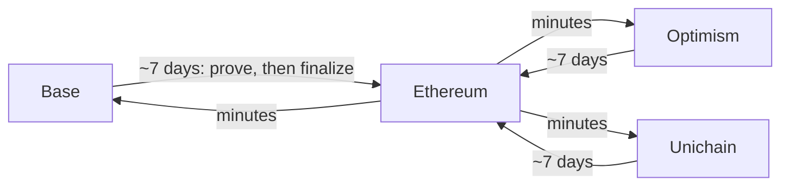

# Governance token (ASWAP)

ASWAP is the Async Swap governance token. It has one address on every chain it lives on, a fixed supply of
1,000,000,000, and voting, permits and flash loans built in. Manage it at
[governance.asyncswap.org](https://governance.asyncswap.org): see supply on each chain, bridge ASWAP, track
withdrawals and delegate votes.

## Address

`0xAAAa13D374d9df074C027d313f317917424dAaAA`

| Chain | Chain id | Explorer |
| --- | --- | --- |
| Base | 8453 | [basescan.org](https://basescan.org/token/0xAAAa13D374d9df074C027d313f317917424dAaAA) |
| Ethereum | 1 | [etherscan.io](https://etherscan.io/token/0xAAAa13D374d9df074C027d313f317917424dAaAA) |
| Optimism | 10 | [optimistic.etherscan.io](https://optimistic.etherscan.io/token/0xAAAa13D374d9df074C027d313f317917424dAaAA) |
| Unichain | 130 | [uniscan.xyz](https://uniscan.xyz/token/0xAAAa13D374d9df074C027d313f317917424dAaAA) |

| Field | Value |
| --- | --- |
| Name | Async Swap |
| Symbol | ASWAP |
| Decimals | 18 |
| Total supply | 1,000,000,000 ASWAP, across all chains |
| Contract | `AsyncSwapV2` |

The token was deployed with CREATE2, using the same bytecode, constructor argument and salt on each chain, so the
address is identical everywhere. Use only this address: any other contract calling itself ASWAP is not the
token.

## Supply

The full 1B was minted once, on Base, at deployment. No one can mint more. Bridging burns ASWAP on the chain it
leaves and mints the same amount on the chain it arrives at, so nothing is escrowed. The total across the four
chains is always 1B. While a transfer is in flight, it has been burned on the source chain and not yet minted on
the destination, so the per-chain totals can add up to less than 1B for that time.

## Bridging

Each OP Stack standard bridge pairs ASWAP with itself (`remoteToken()` returns the token's own address), and
Ethereum is the hub:

- **Into Ethereum** takes about 7 days. Prove the withdrawal once the L2 has posted its output root (about an
  hour), then finalize it after the challenge window.
- **Out of Ethereum** to Base, Optimism or Unichain takes minutes.
- To move between two L2s, go through Ethereum.

The governance app runs all of these steps, including prove and finalize.

**Who can mint and burn:**

- On Base, Optimism and Unichain: that chain's L2StandardBridge (`0x4200000000000000000000000000000000000010`)
  and the SuperchainTokenBridge (`0x4200000000000000000000000000000000000028`).
- On Ethereum: the L1StandardBridge of Base, Optimism and Unichain. Each one mints only when it finalizes a
  withdrawal from its own chain, where the tokens were already burned.
- On any other chain: no one.

Direct L2-to-L2 transfers through the SuperchainTokenBridge (ERC-7802) are built in and will work once Superchain
interop is live on mainnet. Until then, use the routes above.

## Voting

ASWAP implements `ERC20Votes`. Voting power comes from delegation, not from holding: a balance counts only after
its holder delegates, either to someone else or to themselves. Delegate in the governance app, by calling
`delegate(delegatee)`, or without gas with a signed `delegateBySig`.

- The votes clock is the block timestamp (`CLOCK_MODE()` returns `mode=timestamp`), so past voting power is read
  by time: `getPastVotes(account, timepoint)` and `getPastTotalSupply(timepoint)`.
- Votes are tracked separately on each chain, and count only the ASWAP held on that chain. Bridging moves the
  balance, and the voting power with it once the receiver has delegated on the destination chain.
- No governor contract is deployed yet. The token records voting power for one to use.

## Permits and flash loans

- **Permit (ERC-2612):** approve with a signature instead of a transaction. The EIP-712 domain name is
  `Async Swap`.
- **Flash loans (ERC-3156):** `flashLoan` mints ASWAP to the borrower and burns it when it is repaid in the same
  transaction. There is no fee.

## Security

Report security issues with the token to support@asyncswap.org.
