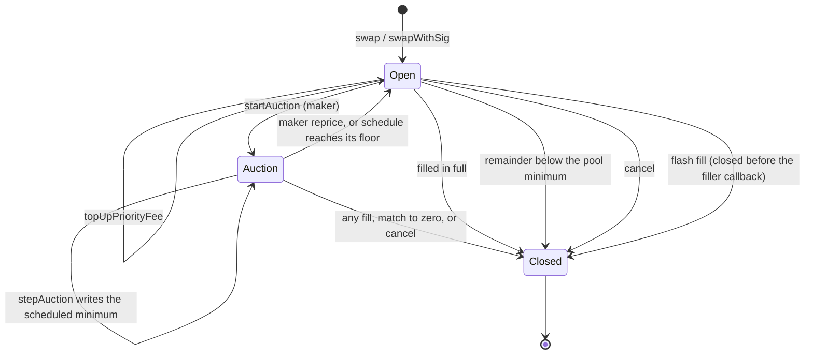
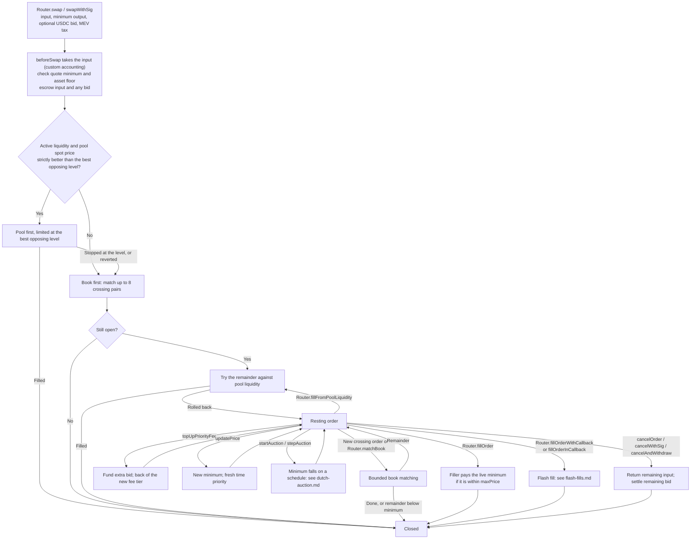
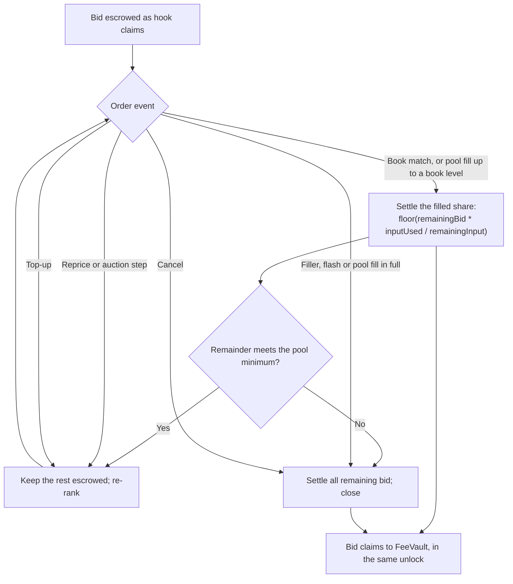

# Order lifecycle and priority bids

Orders are good till cancelled (GTC). The order struct has no expiry, and nothing closes an order on a timer: it
rests until it is fully filled or the maker cancels it. A signed message (`swapWithSig`, `updatePriceWithSig`,
`cancelWithSig`) carries a `deadline`, but that only limits when the signature can be submitted.

See the [protocol overview](protocol.md) for the contracts and the [call sequences](contract-call-sequences.md)
for each step as calls.

## States

A closed order is deleted. Its remaining bid settles to the FeeVault and any unused input returns to the maker.

## Lifecycle

Book matching ranks the best opposing price first; a higher escrowed USDC bid breaks ties at one price, then
earlier submission. Filler fills, flash fills and pool-fill retries target one order and do not follow the book's
queue.

Notes:

- `updatePrice` only re-ranks the order. It needs no unlock and triggers no matching; a later crossing order,
  `matchBook`, a filler or a pool-fill retry executes it. Each reprice increments `orderReprices`, which voids
  older signed reprices.
- `Router.matchBook` accepts 1 to 8 pairs and does not retry pool liquidity. `matchBook` skips a pool while a
  new order on it is still being funded.
- A crossing arrival on a pool with no active LP liquidity is staged in transient storage by `IncomingMatching`
  while it is funded, matched in memory against the book, and only its remainder is stored.
- Book-match proceeds and refunds below the pool minimum are paid as PoolManager claims, so a token that refuses
  a recipient cannot block matching. Filler and pool fills pay ERC-20 output directly; native output is paid as
  claims (id 0). Flash fills pay the filler in claims.
- Holders redeem claims through `TokenClaims`, `NativeClaims` or `Router.withdrawClaims`.
  `Router.cancelAndWithdraw` cancels and withdraws native input in one step.

Sources: [Router](../src/Router.sol), [AsyncSwap](../src/AsyncSwap.sol),
[IncomingMatching](../src/libraries/IncomingMatching.sol), [AsyncMatching](../src/libraries/AsyncMatching.sol),
[AsyncFiller](../src/libraries/AsyncFiller.sol).

## Priority bids

Bids are optional and paid in USDC, so only numeraire pools accept them. A zero-bid order pays nothing and keeps
time priority among zero-bid orders. A nonzero bid is escrowed and **non-refundable**; it must be at least
`min(0.10 USDC, 0.1% of the order's USDC notional)`. Bids rank same-price orders in the book; they do not buy
block inclusion. The chain's priority fee is a different thing: the Router taxes it (the MEV tax, see the
[overview](protocol.md#2-where-funds-live)).

Bids always go to the FeeVault, never to LPs, so liquidity added just before a settlement earns none of them. A
failed pool-fill self-call rolls back its fee and bid changes and keeps earlier book matches.

Raising a sell's minimum output requires a nonzero remaining bid to meet the new notional's bid floor. A
partially filled order keeps its prorated bid when repriced to unchanged or lower terms. Sources:
[`_reduceAfterMatch` and `_settleMatchedPriorityFee`](../src/libraries/AsyncMatching.sol),
[`settlePriorityFee`, `fill` and `cancel`](../src/libraries/AsyncFiller.sol).

## Top-ups, cancels and withdrawals

- `Router.topUpPriorityFee(order, addedFee)` funds a larger bid. The order joins the back of its new fee tier;
  its input, limit price and maker age stay the same. See [priority fee top-ups](priority-fee-top-ups.md).
- `Router.cancelAndWithdraw(order)` cancels and sends native input straight to the maker's wallet, given an
  exact claim allowance for id 0. ERC-20 cancels already return tokens.
- `Router.withdrawClaims(currencies, amounts)` redeems up to 16 currencies of the caller's own claims.
- `Router.multicall(calls)` batches any of these atomically, each as the caller.
