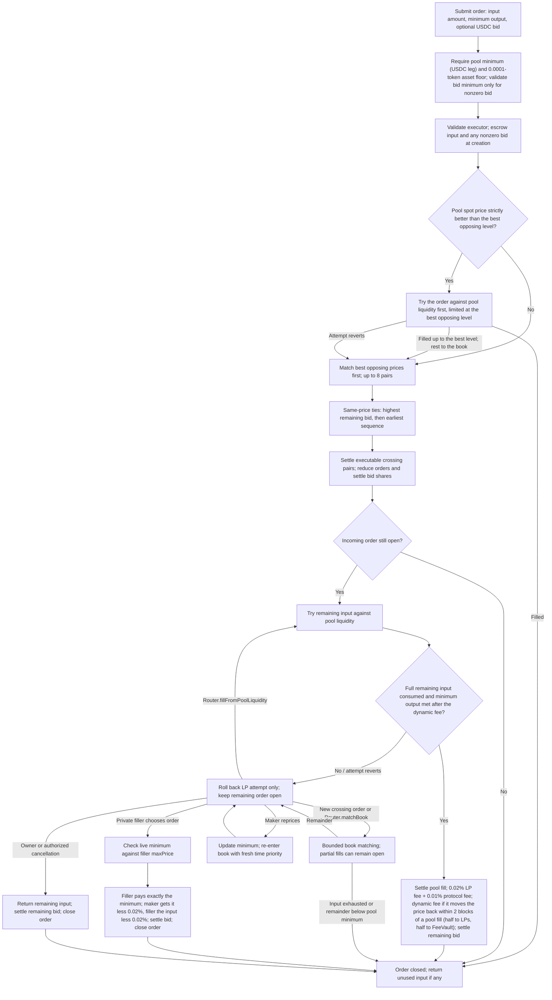
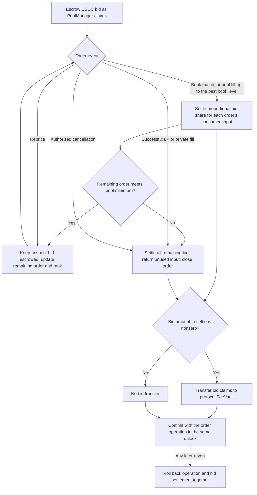

# Order lifecycle and priority bids

Current behavior, checked against the contract source. See also [contract call sequences](contract-call-sequences.md) and the [README](../README.md).

## Order lifecycle

These diagrams describe the current source, not a deployment or mainnet-readiness guarantee. Book matching ranks the best opposing price first; higher escrowed USDC bids break ties at that price, followed by earlier submission. Zero-bid orders are valid and keep time priority behind paid bids. Private fills and explicit LP retries target a specific order and do not enforce the book's global priority queue.

If no executable crossing pair exists, the initial matching pass leaves the order unchanged before the LP attempt. `Router.matchBook` accepts a bound of 1–8 pairs and does not itself retry LP liquidity. An LP retry does not require the order to be first in the book. Private fills require a maker-authorized executor (normally the Router); the filler pays exactly the live minimum in the same transaction, and the 0.02% trade fee comes out of each side's proceeds. That trade fee is separate from the LP fee on pool-liquidity fills. Book-match proceeds, and input returned below the pool minimum, are credited as PoolManager claims in every currency, redeemable through `TokenClaims` (ERC-20), `NativeClaims` (ETH) or `Router.withdrawClaims`; native fill proceeds and refunds are claims too. Filler and LP fills pay ERC-20 output directly, except a pool-first fill that stops at the best book level: the order stays open for the book, so its output is credited as claims. When the pool goes first, a remainder below the pool minimum that the book leaves is returned as claims.

Sources: [Router](../src/Router.sol), [AsyncSwap](../src/AsyncSwap.sol), [AsyncMatching](../src/libraries/AsyncMatching.sol), and [AsyncFiller](../src/libraries/AsyncFiller.sol).

## Priority-bid settlement

Priority bids are optional. An order with no bid pays no priority fee at creation and keeps time priority among other zero-bid orders. A nonzero bid is escrowed in USDC and is **non-refundable**; it must be at least `min(0.10 USDC, 0.1% of the order’s USDC notional)`, rounded down to base units. An unlock cannot finish with an unpaid nonzero bid debt. Bids rank same-price orders within the book; they do not purchase block inclusion or transaction ordering from the chain. The chain's own priority fee is a different thing: the Router taxes it on order creation and fills (the MEV tax, see [protocol.md](protocol.md)), so an order sent with no priority fee pays no tax.

For each book match, the settled share is `floor(remainingBid * inputUsed / remainingInputBeforeFill)`. If the order terminates, any residual bid is settled too; it is never returned to the maker. A partial fill can leave a bid below the creation minimum. Its remaining bid determines its new same-price rank. If the remaining price key changes, it also receives a fresh sequence number. Maker repricing always assigns fresh time priority without refunding the bid.

Bids always go to the FeeVault, whatever liquidity is in range, so liquidity added for the moment of settlement captures none of them. A failed LP self-call rolls back that attempt, including its fee and bid changes, while preserving prior successful book matches in the surrounding transaction. A revert of the surrounding transaction rolls everything back.

Sources: [`_reduceAfterMatch` and `_settleMatchedPriorityFee`](../src/libraries/AsyncMatching.sol), [`settlePriorityFee`, `fill`, and `cancel`](../src/libraries/AsyncFiller.sol). The [original chat diagrams](historical-matching-diagrams.md) are retained as historical references.

Raising a sell's minimum output requires any nonzero remaining bid to meet the new notional's bid floor; a zero bid remains valid.
A partially filled sell can retain its prorated bid when repricing to unchanged or lower terms.
Book selection compares exact prices first, even within a shared tick; fee and queue age only
break exact-price ties. Settlement age remains the immutable creation sequence.

### Cancel and withdraw

The updated Router exposes `cancelAndWithdraw(order)`. The maker authorizes that
Router as an executor for the pool and approves its exact native claim allowance
on PoolManager (claim ID 0). Cancellation and withdrawal then execute atomically:
the remaining native input goes directly to the maker's wallet, while pre-existing
claims are left untouched. ERC20 cancellation already returns real tokens.
A failed withdrawal reverts the cancellation as well.

`withdrawClaims(currencies, amounts)` redeems existing native or ERC20 PoolManager
claims to the caller's wallet. Approve each currency's ERC-6909 claim ID on
PoolManager; an ERC20 approval is not a claim approval. The Router accepts up to
16 distinct currencies and never withdraws another wallet's claims.

`Router.multicall(calls)` batches these with `cancelOrder` and other Router calls in
one atomic transaction, each running as the caller: for example, cancel several
orders and withdraw the resulting claims together. If any call fails, the whole
batch reverts. It replaces the earlier BatchActions, BatchCancels and BatchClaims
contracts, which needed their own executor and operator grants. `multicall` is not
payable, so send native-value calls on their own.

For existing immutable hooks, an updated Router can be deployed alongside the
creation Router. The registry records it as `WithdrawalRouter`; `Router` remains
the original creation route. Existing orders and balances do not move.
