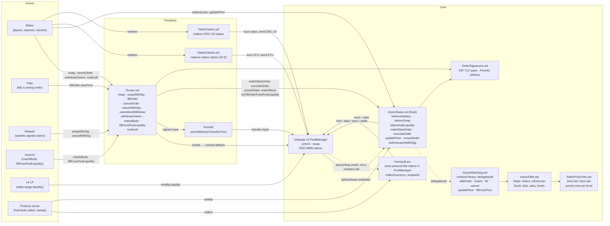
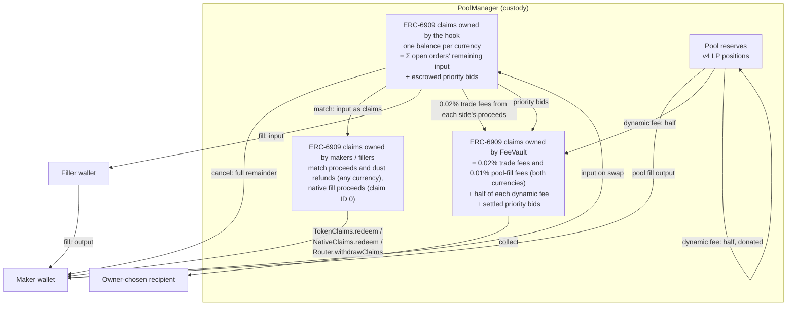
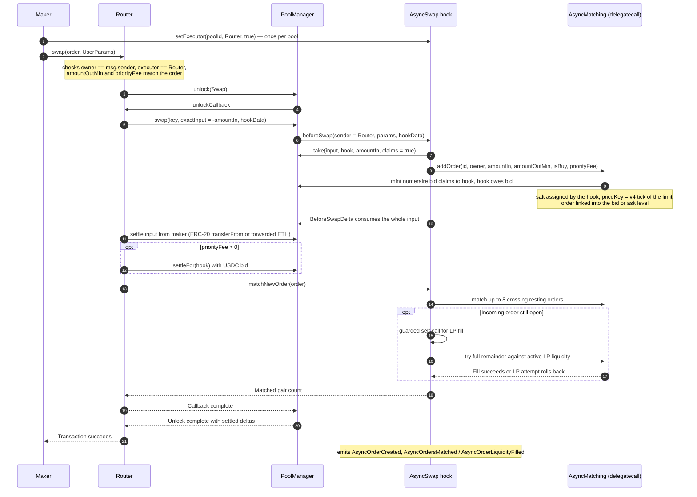
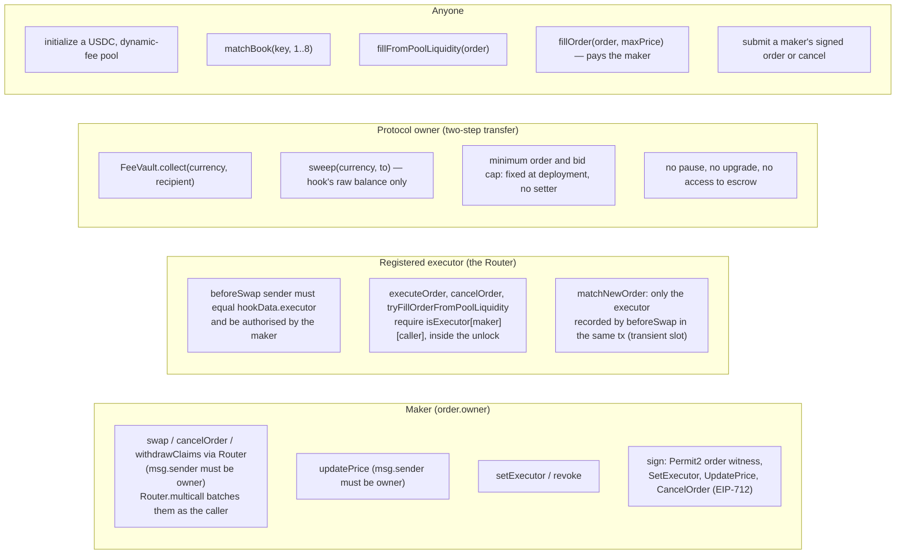
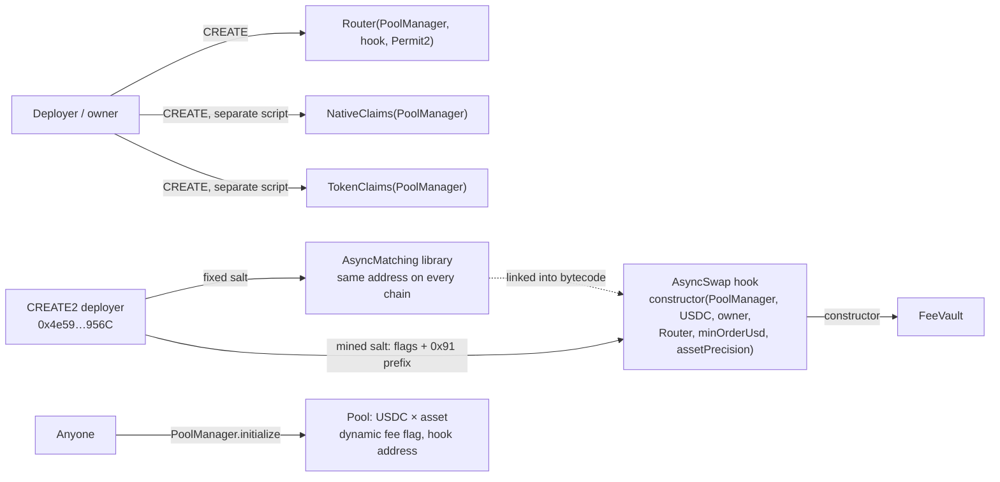

# Async Swap protocol map

Async Swap is a Uniswap v4 hook that turns exact-input swaps into resting limit orders. This page
describes the whole protocol in diagrams: which contracts exist, where funds sit, how an order is
created, matched, filled, repriced and cancelled, and who is allowed to do what. Every box names a
contract, library or function in `src/`, so the diagrams can be checked against the code.

## 1. Components

Anyone may open a pool on the hook, as long as it contains the chain's USDC (`numeraire`) and uses the
dynamic-fee flag (`beforeInitialize`). Every order must meet two floors, both fixed when the pool opens:

- **Minimum order**, on the USDC leg (a buy's input, a sell's minimum output). The hook's constructor
  takes it in whole dollars and scales it by the numeraire's `decimals()`. No check reads the pool
  price, so the initial price an opener chooses cannot block orders.
- **Asset floor**, on the asset leg (a sell's input, a buy's minimum output): at least 0.0001 of a whole
  token, `10^(decimals - assetPrecision)` base units with the deployed precision of 4. The hook reads
  the asset's `decimals()` once when the pool opens (native ETH counts as 18; a token without
  `decimals()` gets a 1-unit floor). This blocks literal dust such as 1-wei sells; it limits quantity,
  not value.

Neither floor, nor the $0.10 priority-bid cap (`10^(decimals - 1)` of the numeraire), has a setter: the
owner cannot change the rules under live orders. `beforeAddLiquidity` is a pass-through: anyone may add
ordinary v4 range positions, and they are the inventory for the LP-fill path. No swap ever reaches the AMM curve
directly, because `beforeSwap` consumes the whole input as an order; the only AMM swaps are the ones
the hook itself performs when it fills a resting order from pool liquidity. The standalone
`MatchingEngine.sol` is a benchmark harness and is not deployed.

FeeVault owns claims recorded in PoolManager. Crediting those claims does not call FeeVault.

## 2. Where funds live

Fees, by path. A book match and a filler fill (`Router.fillOrder`) take a 0.02% trade fee, rounded up,
from what each side receives, and credit it to the FeeVault as claims: in a match the buyer receives the
asset less 0.02% and the seller the quote less 0.02%; in a filler fill the filler pays exactly the
maker's live minimum, the maker receives that minimum less 0.02%, and the filler receives the input less
0.02%. A maker's guarantee is therefore its minimum output minus 0.02%. Refunds and cancels are not
charged. An LP fill sends 0.01% of the input to the FeeVault and swaps the rest at a 0.02% dynamic LP
fee for the active v4 positions; it still pays the full minimum. `calculatePoolFee` (a surcharge on top
of the minimum) and `calculateHookFee` are zero.

Dynamic fee ordering (`DynamicFeeOrdering`). The first pool fill in a window of 2 blocks records the pool's
tick before it as the reference. A later pool fill in that window that moves the price back toward the
reference pays a dynamic fee from its output: half the price gap it closes, `amountOut * (gapBefore +
gapAfter) / 4` in units of 0.01% (one tick), capped at half the output. The gap is averaged over the
fill's start and end ticks, so splitting a backrun into several orders costs about the same. Half of
the dynamic fee is donated to in-range LPs and half is credited to the FeeVault as claims (all of it to
the FeeVault if no liquidity is in range). The dynamic fee is taken in the fill's output currency; the
maker's minimum must still be met after it. Fills that move the price further from the reference, and
fills after the window, pay none. See [`dynamic-fee-ordering.md`](dynamic-fee-ordering.md).

Fee events. Every fee the hook moves is logged by the hook, with its pool, so indexers never have to
recompute fees from gross amounts:

| Fee | Event | Logged against |
|---|---|---|
| 0.02% trade fee, book match | `OrderFeeAccrued(poolId, orderId, currency, amount)`, one per side | the buy order (asset fee) and the sell order (quote fee) |
| 0.02% trade fee, filler fill | `OrderFeeAccrued`, one per side | the filled order: the maker's fee in the output, the filler's in the input |
| 0.01% protocol fee, pool fill | `OrderFeeAccrued` | the filled order, in the input |
| Dynamic fee, pool fill | `DynamicFeeCharged(poolId, orderId, currency, toLps, toFeeVault, refTick)` | the filled order, in the output |
| 0.02% LP fee, pool fill | PoolManager's `Swap` event (`fee`) | the pool |

`AsyncOrdersMatched` and `AsyncOrderFilled` carry gross amounts; `AsyncOrderLiquidityFilled` carries the
maker's output after the dynamic fee.
Optional priority bids are escrowed as hook claims by `addOrder` and settle to the FeeVault: the filled share
as input fills, the rest when the order closes. A zero bid incurs no escrow or transfer. Bids never go to LPs, so liquidity added just before
a settlement earns none of them.

An order-to-order match pays both sides, and returns any remainder left below the pool minimum, as
PoolManager claims rather than token transfers, so a recipient a token refuses cannot block matching.
Holders redeem ERC-20 claims through `TokenClaims` and native claims through `NativeClaims`, to any
recipient, after approving the redeemer for that claim id, or to their own wallet through
`Router.withdrawClaims` with exact per-claim allowances. Filler fills and LP fills pay the maker's
ERC-20 output directly. Minting bid
claims creates hook debt immediately; the PoolManager unlock must settle that debt, including for
custom executors. The Router pays it with `settleFor(hook)`. All pools rank equal prices by remaining
bid, then sequence, so zero-bid orders remain time-prioritized. There is no FIFO mode or mode switch.

The accounting invariant is fuzzed by the matching invariant suites: the hook's claim balance for
each currency equals the sum of remaining inputs of open orders plus escrowed bids, and nothing is
created or destroyed by a match. The hook's own token balance is zero between transactions, so
`sweep` can only move stranded ETH or tokens sent to the hook by mistake, never escrow.

## 3. Placing an order

Signed orders follow the same path through `swapWithSig`. The maker signs one Permit2
`PermitWitnessTransferFrom` whose witness is `OrderSignatures.hashOrder(order)`, so the signature
both moves the input and commits to the order. A relayer can also attach a signed `SetExecutor` grant
for the maker's first order on a pool.

## 4. Everything after placement

Filler fills, book continuation, LP retries, repricing, cancellation, pool setup, native-claim
redemption and fee collection are drawn step by step in
[`contract-call-sequences.md`](contract-call-sequences.md); the lifecycle and priority-bid flowcharts
are in [`order-lifecycle.md`](order-lifecycle.md). Three facts to keep in mind while reading them:

- Book matches and filler fills take 0.02% of what each side receives, credited to the FeeVault as
  ERC-6909 claims inside the PoolManager; the LP-fill path charges 0.02% to active v4 positions and
  0.01% to the FeeVault, plus a dynamic fee on fills that move the price back within 2 blocks of a
  pool fill (half to LPs, half to the FeeVault). Matching compares the signed limits, so the fee never changes which orders
  cross. `calculatePoolFee` and `calculateHookFee` are zero.
- A new order goes to the better venue first. If the pool has active liquidity and its spot price is
  strictly better than the best opposing book level, the hook tries the pool fill first and matches the
  book only if that fails; otherwise it matches the book first and tries the pool for any remainder.
  The comparison uses spot price, so it ignores the pool fill's fees and price impact.
- `updatePrice` only re-ranks the order in the book. It needs no PoolManager unlock and triggers no
  matching; a later crossing order, `matchBook`, a filler or an LP retry has to execute it.
- `matchNewOrder` is gated by a transient slot that `beforeSwap` writes for
  the current transaction. `executeOrder`, `cancelOrder` and `tryFillOrderFromPoolLiquidity` check
  `isExecutor[maker][caller]` instead.

An order's identity is `keccak(chainId, poolId, owner, zeroForOne, salt)`. The hook assigns the
salt at creation and emits it in `AsyncOrderCreated`; later calls recompute the id from the maker's
struct, so a maker needs the event or an indexer to cancel or reprice.

## 5. Authorization

`Router.multicall` runs several Router calls in one atomic transaction, each as the caller, so a maker
can cancel many orders and withdraw claims at once without granting any other contract executor or
operator rights. It is not payable: native-value actions (`swap` with native input, `fillOrder` with
native output) must be sent on their own, so no two calls can count one `msg.value`.

Revoking the Router with `setExecutor(poolId, router, false)` strands the maker's live orders on that
pool: Router cancels and fills revert until the maker grants it again, while book matching can still
consume them. A contract maker can cancel directly from its own unlock; an EOA has to re-grant first.

Signed maker actions use unordered nonces: `AsyncSwap.nonceUsed` for `SetExecutor`,
`UpdatePrice` and `CancelOrder` (the Router burns cancel nonces through `AsyncSwap.useNonce`, so
`invalidateNonce` revokes any of them), and Permit2's own nonces for order witnesses. The Permit2 witness binds maker, both tokens, amounts, bid and pool; it leaves out
`sqrtPrice` (never read, the hook consumes the whole swap) and `salt` (assigned by the hook).

## 6. Deployment shape

`script/deploy.sh <chain-key> [dry-run|broadcast|verify]` runs this sequence against
`script/config/chains.json`. It passes `DEPLOY_MIN_ORDER_USD` (default 10) and an asset precision of 4;
the constructor reads the numeraire's decimals (1 to 20) and derives the base-unit minimum and the
$0.10 bid cap itself. On chains whose gas token has an ERC-20 twin (Arc: native USDC and
`0x3600…0000` are one balance) never initialize a native-currency pool; pair the ERC-20 USDC with a
normal ERC-20 asset.

See also [`price-key-crossing.md`](price-key-crossing.md) for how truncated price keys decide
whether two orders cross, and [mainnet readiness](../MAINNET_READINESS.md) for the release gate.

Signed cancellation typed data includes `uint64 createdSequence` after `orderId`; read it through
`orderCreatedSequence(poolId, orderId)`. Signed repricing instead includes `uint64 sequence`, the order's
current queue sequence (from `orderBookOrder`), which every reprice moves on: an unrelayed reprice
signature cannot undo a later reprice, and replacing an identically identified order does not revive
old signatures of either kind. Repricing signatures made with `createdSequence` must be signed again.
`invalidateNonce` revokes the shared grant, reprice, and cancel nonce space.
